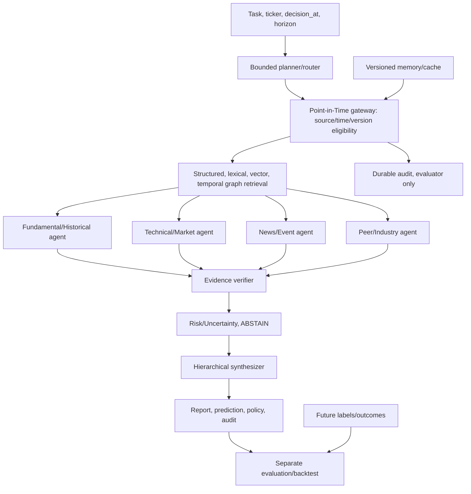

# Đề cương nghiên cứu PiT-HAF

Cập nhật: 06/10/2026. Bản đề xuất 0.1, chưa freeze protocol và chưa có kết quả
thực nghiệm. Bản trước sửa được giữ trong snapshot audit local; tài liệu này
thay kế hoạch Mỹ/48 giờ bằng phạm vi Việt Nam đầy đủ theo các milestone.

Tiến độ kỹ thuật ngày17/10: đã cài Ollama, thêm snapshots/gateway và chạy
pilot trích xuất; xem [báo cáo08](research/08-local-pilot-results.md). Phần
"trạng thái hiện tại" ở cuối ghi mốc khảo sát06/10; chưa có kết quả dự báo/backtest.

## 1. Tên và mục tiêu

**Tiếng Việt:** PiT-HAF: Khung Agentic-RAG phân cấp có kiểm soát Point-in-Time
cho phân tích và hỗ trợ quyết định cổ phiếu Việt Nam.

**Tiếng Anh:** PiT-HAF: A Point-in-Time Hierarchical Agentic-RAG Framework
for Vietnamese Stock Analysis and Decision Support.

Thị trường chính là Việt Nam. Mỹ chỉ là tham khảo literature hoặc chuyển miền
khi có yêu cầu sau. Dùng LLM pretrained, ưu tiên inference local qua Ollama;
không bắt buộc training từ đầu hoặc fine-tuning. Nhiều vai trò agent có thể
chia sẻ một model và gọi lần lượt mà vẫn giữ kiến trúc phân cấp đầy đủ.

Mục tiêu là hệ thống chạy thật, phương pháp kiểm chứng được, thực nghiệm có
đối chứng và hồ sơ giúp sinh viên giải thích/bảo vệ. Tên HAF, agent phân cấp
và graph đã có tiền lệ; không tự xem chúng là tính mới của khóa luận.

## 2. Tác vụ chính và dữ liệu

Tại `decision_at`, phân tích doanh nghiệp từ bằng chứng đã khả dụng, sinh báo
cáo có citations và dự đoán hướng lợi suất **5 phiên**. Đơn vị mẫu đề xuất là
một sự kiện công bố BCTC hợp nhất; loại báo cáo/công bố khác bổ sung retrieval.
Bản sửa không tự tạo mẫu độc lập trong thí nghiệm chính.

Decision đề xuất lúc 16:00 Asia/Ho_Chi_Minh của phiên đầu có đủ bằng chứng theo
policy đã đăng ký. Phiên giao dịch kế tiếp là s0; nhãn dùng
`close(s4) / open(s0) - 1`, gồm 5 phiên s0–s4. UP nếu dương, DOWN nếu không dương.
ABSTAIN xử lý thiếu evidence/lỗi/bất định, được báo cáo bằng coverage riêng.
Giá open/close là mốc tham chiếu; không chứng minh có thể khớp đúng giá đó.

Giữ prediction, confidence và policy danh mục riêng. Cấu hình đầu long-only,
UP có thể mở vị thế theo ngân sách 1/N_universe; DOWN/ABSTAIN không mở mới.
Tồn kho và lệnh thoát đã cam kết phải tuân thủ timeline/lịch thanh toán. Engine
phải xác minh quy định Việt Nam theo giai đoạn trước khi gọi mô phỏng khả thi.
Labels/giá tương lai chỉ evaluator đọc, không đưa vào agent hoặc retrieval.

Thu thập OHLCV, VNINDEX, BCTC, báo cáo thường niên, giải trình/công bố và tin có
provenance. Pilot mục tiêu 24 case thật, sau đó hướng tới 10–20 mã/ít nhất 3
ngành/vài năm nếu nguồn đáp ứng. Chọn theo coverage đăng ký trước, không theo
lợi suất tương lai. Universe lịch sử/delisting thiếu phải ghi survivorship bias.
Chưa có corpus đủ để xác nhận cỡ mẫu hoặc chọn model.

Chi tiết công thức, timestamp chỉ có ngày, giá điều chỉnh, corporate actions,
policy và các quyết định cần xác nhận nằm trong [task protocol](research/01-task-protocol.md).

## 3. Câu hỏi nghiên cứu

| RQ | Câu hỏi kiểm chứng | Đối chứng và phép đo chính |
|---|---|---|
| RQ1 | Gate và lựa chọn đúng revision giảm tiếp xúc bằng chứng tương lai thế nào? | Future/revision injection; exposure thực sự, version error; no-gate chỉ diagnostic |
| RQ2 | Phân cấp giúp phân tích/dự đoán và coverage thế nào trên cùng dữ liệu/model? | PiT single-agent, multi-agent đối chứng, PiT-HAF; rubric/F1/MCC/coverage và budget |
| RQ3 | Verifier giảm claim thiếu căn cứ, citation và số liệu sai với chi phí nào? | Bỏ verifier; gold quote/numeric/claim support, latency/tokens/failure |
| RQ4 | Hybrid retrieval, graph và peer thêm giá trị gì so với vector-only? | Ablation tách các thành phần; retrieval gold, report quality, prediction |
| RQ5 | Memory kiểm soát thời gian giúp gì và kết quả ổn định đến đâu? | Bỏ memory; replay quá khứ sau tương lai, ngành/regime/data quality/model robustness |

Giả thuyết về cải thiện phải được kiểm định; không đặt kết luận tích cực làm
điều kiện thành công. Kết quả âm vẫn có giá trị nếu phương pháp, failures và
phân tích giới hạn được báo cáo đủ.

## 4. Literature và đóng góp dự kiến

Đã đối chiếu phương pháp/giới hạn trong paper gốc
[CARAG](https://aclanthology.org/2026.eacl-long.141/),
[Look-Ahead-Bench](https://arxiv.org/abs/2601.13770) và
[Profit Mirage](https://arxiv.org/abs/2510.07920).
Chưa tái hiện code của các paper; TradingAgents/FinMem/MASTER mới kiểm metadata
và abstract trong lượt khảo sát. Chưa có systematic review để tuyên bố tính mới.

| Phần | Artifact đề xuất | Đánh giá | Trạng thái |
|---|---|---|---|
| C1: evidence có provenance/revision | Schema, raw snapshots, source/time proof, version query | QA nguồn, wrong-version/late-publication cases | Guard nhỏ đã có; schema/pipeline đầy đủ chưa có |
| C2: gateway xuyên vòng đời | Retrieval/tool/cache/graph/memory/memo cùng eligibility | Future injection và replay không đổi context hợp lệ | Đề xuất tích hợp, chưa hiện thực |
| C3: orchestration có kiểm chứng | Contracts, bounded workflow, verifier/risk/ABSTAIN, trace | Hierarchy/verifier/memory ablations + costs | Kế thừa vai trò, đề xuất kiểm soát, chưa hiện thực |
| C4: bộ đánh giá Việt Nam | Samples/splits/labels/gold evidence/rubric/data card | Coverage, agreement, metrics/paired CI | Chưa thu thập/gán nhãn đủ |
| C5: gói tái lập | Manifest/digests/raw responses/failures/replay | Một case replay và experiment matrix | Doctor source snapshot đã có; runner nghiên cứu chưa có |

[Ma trận contribution/literature](research/02-literature-contributions.md)
phân biệt kế thừa, tích hợp, đề xuất và claim cần xác nhận. Schema có event và
availability chưa đủ gọi bi-temporal: cần semantics thời gian hệ thống và query
lịch sử đầy đủ nếu dùng thuật ngữ đó.

## 5. Kiến trúc và ràng buộc thời gian

Mọi document/chunk/fact/edge/tool/cache/memory/memo phải hợp lệ tại cutoff.
Chọn revision sau khi loại tương lai. Eligibility áp dụng trước candidate set,
corpus statistics, reranking và context; không mặc định metadata filter đủ với
ANN/BM25. Derived memo cần lineage hợp lệ; cache phải chứa cutoff/snapshot/
config/model/prompt; memory baseline và replay phải cô lập. Audit có thể giữ
metadata tương lai cho evaluator, không đưa metadata đó vào prompt.

Graph có evidence/time/version, phân biệt quan hệ được tác giả báo cáo với
suy luận LLM; không coi tên causal graph là chứng minh nhân quả. Verifier tách
kiểm quote/locator/time/số học deterministic với semantic/human checks.
Confidence tự báo không mặc định là probability đã calibration.

Structured adapter có schema validation, timeout/retry/budget hữu hạn, raw
response và model digest/config. Không âm thầm đổi model khi lỗi. Mock chỉ dùng
kiểm thử, có nhãn và bị loại khỏi bảng nghiên cứu. Temporal gate kiểm dữ liệu
ngoài, không loại bỏ tri thức tương lai trong trọng số LLM.

Contracts, budgets, threat model và sơ đồ timeline trong
[kiến trúc đầy đủ](research/03-architecture.md).

## 6. Thực nghiệm và tiêu chí đánh giá

Nhóm định lượng: Buy & Hold, Equal Weight, VNINDEX đối chứng chỉ số,
Momentum/MA và Logistic Regression cùng feature/cutoff. Nhóm LLM: single LLM
không retrieval, naive vector RAG trên corpus hợp lệ, PiT single-agent,
multi-agent đối chứng và PiT-HAF. Giữ universe/samples/split/model/timeline,
báo budget và so sánh theo token budget; portfolio baseline không có F1.

Ablation đầy đủ: hybrid/vector-only (tách thêm lexical/structured), graph,
peer, hierarchy, verifier, memory. No-gate/future injection chỉ chẩn đoán
leakage, không là thành tích đầu tư. Masking và counterfactual là stress tests,
không chứng minh đã loại memorization. External paper baselines có thể thêm
khi tái hiện phù hợp; không gọi bản rút gọn là reproduction chính xác.

Split train/development/validation/test theo thời gian, purge label intervals,
embargo theo horizon; prompt/model/scaler/threshold/calibration chỉ fit trên
phần được phép. Freeze trước test. Báo denominator, coverage/ABSTAIN/failures,
metric evidence/time/version, prediction, net/gross backtest và hệ thống.
Bootstrap paired theo block thời gian/sự kiện, xử lý multiple comparisons;
không coi mọi mã cùng ngày là độc lập hoặc thiếu significance là tương đương.

Gold rubric chấm citation/support/numeric/coverage/report quality bằng người,
đo agreement nếu có hai người; một người phải công bố giới hạn và chấm lại.
Không dùng chính model thử nghiệm làm ground truth duy nhất.

Công thức, matrix, rubric và protocol thống kê nằm trong
[đặc tả thực nghiệm](research/04-experiments-metrics.md).

## 7. Lộ trình và tài nguyên

Giữ toàn bộ phạm vi qua M1–M7: audit/đặc tả/literature/data/local pilot;
snapshot/gateway/quant; adapter/hybrid PiT single-agent; graph/peer/specialists/
hierarchy; verifier/risk/memory/audit/UI; freeze/full experiments/statistics;
replay/thesis/demo/slides. Viết luận văn từ M1, gắn từng claim với artifact.

Khung ban đầu 8–12 tuần, khoảng 210–360 giờ người làm, chưa tính compute.
Đây là ước lượng có phụ thuộc, không cam kết; nếu cần tăng thời gian/tài nguyên
sẽ báo tác động và giữ scope. [Roadmap](research/05-roadmap.md) có acceptance,
pass/fail, lệnh kiểm chứng dự kiến và dependencies.

RAM tổng đo khoảng 15,40 GiB; RAM trống một lần đo chỉ khoảng 2,70 GiB.
GPU RTX 3050 Laptop 4096 MiB. Không có inference benchmark. Chưa thấy Ollama
ở các vị trí đã kiểm tra hoặc service default hoạt động; chưa kết luận không
cài ở nơi khác. qwen3:4b Q4_K_M chỉ là candidate, cần pilot 20–30 case thật để
đo quality/JSON/tokens/latency/RAM/VRAM trước chốt; artifact size khác peak memory.

[Nguồn và pilot](research/06-data-local-pilot.md) tách bằng chứng truy cập/terms
đã kiểm tra với timestamp/model/coverage chưa xác minh. Không dùng API trả phí,
publish hoặc giao dịch thật khi chưa có ngân sách/yêu cầu xác định.

## 8. Trạng thái hiện tại và nghiệm thu

Provider Việt Nam và Guard độc lập đã có; UI chuyển về FPT/VND và VNINDEX.
Doctor lưu môi trường/service/Git diff/hashes/code snapshot; tests/CI offline
đã thêm. Chưa có retrieval, LLM inference, graph, agent workflow, durable
memory, engine backtest hoặc runner tạo kết quả khoa học. M1 đã bắt đầu, chưa
đạt toàn bộ acceptance corpus/local pilot.

[Audit](research/00-audit.md) ghi hiện trạng trước sửa;
[hướng dẫn M1](research/07-milestone-1.md) ghi thay đổi, lệnh và kết quả mới.
Trường, giảng viên, mẫu luận văn, deadline cụ thể và ngân sách còn chưa xác định.
Checklist/test pass không bảo đảm điểm khóa luận; đích nghiệm thu là phương
pháp giải thích được và bằng chứng thực nghiệm trung thực, kể cả kết quả âm.
