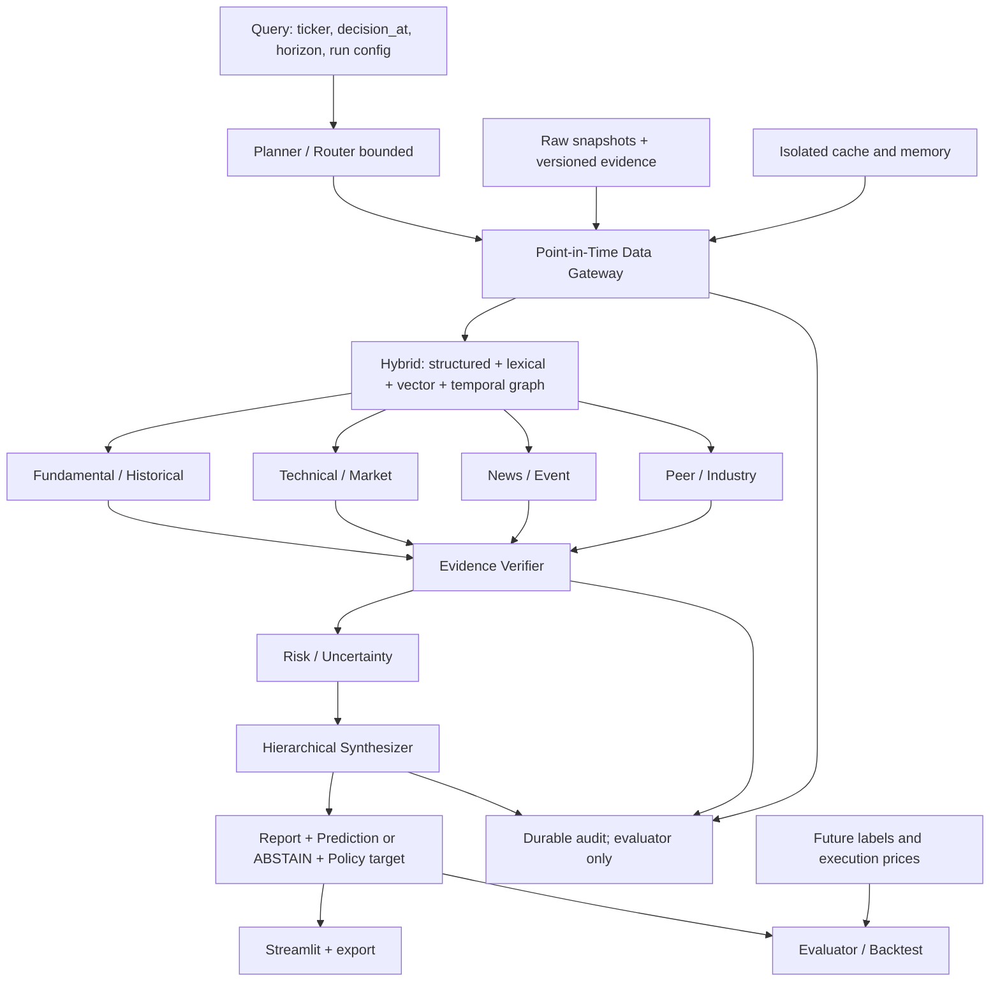

# Kiến trúc đầy đủ và contracts — bản thiết kế 0.1

Đây là đích triển khai đầy đủ, không thu gọn thành một chuỗi prompt. Hiện mới
có provider, Guard độc lập, UI quan sát giá và doctor; các module khác dưới đây
là **thiết kế**. Dùng một model lần lượt cho nhiều vai trò là cách chạy trên
máy hiện tại, không loại agent/graph/memory khỏi kiến trúc.

Audit không đưa metadata future vào agents. Evaluator có nhãn/giá tương lai,
nhưng planner/tools/memory của agent không có quyền đọc vùng label.

## Modules và hợp đồng

| Module dự kiến | Input | Output / invariant | Backend đầu tiên |
|---|---|---|---|
| data/providers | source/config/date | raw bytes + acquisition log; lỗi có trạng thái | Vnstock/KBS, official IR adapters |
| data/snapshots | bytes + source metadata | immutable content-addressed file + checksum | filesystem, SQLite registry |
| data/evidence | raw snapshot + extractor | document/chunk/fact version + offsets/page/unit | Pydantic contracts, SQLite/Parquet |
| data/gateway | query/cutoff/snapshot/strictness | eligible latest revisions + allow tokens + audit | mở rộng Guard hiện có |
| retrieval | eligible corpus + query/config | ranked evidence IDs/locators + method/score | exact cosine pilot, time-sliced lexical/structured |
| graph | eligible facts/peer mapping | nodes/edges cùng lineage/time/version | bảng SQLite edges; adapter thay được |
| llm | role prompt + allowed context/schema | validated JSON, raw response, usage/failure | Ollama local; API adapter chưa bật khi chưa ngân sách |
| agents/planner | task + budgets | bounded DAG/tool requests; kết thúc reason | state machine + typed tool registry |
| agents/specialists | bounded evidence/tool access | claims + evidence IDs + missing/conflicts + memo | shared local model, sequential |
| verification | claims + exact revision/locator | deterministic pass/fail + semantic adjudication | code checks trước; model/human kiểm support |
| risk/synthesis | verified memos + risk inputs | report/prediction/abstention/target tách biệt | typed output; policy deterministic |
| memory/cache | branch/model/config/snapshot/cutoff | only dependencies valid; no cross-arm reuse | SQLite + explicit cache namespaces |
| audit | events + dependency lineage | append-only ledger, delivery/context hashes | JSONL + SQLite |
| backtest | policy decisions + isolated execution data | orders/trades/cash/holdings/equity/assumptions | deterministic event engine |
| evaluation | decisions + gold labels/rubric | metrics/CI/failure reports, no agent access | chronological runner |
| UI | persisted run outputs/provider | quan sát đúng trạng thái, export được | Streamlit |

Contract `RunContext`: run/sample ID, branch ID, ticker, decision_at, horizon,
snapshot_hash, protocol/split/config versions, budget, model digest và prompt
hash. Một artifact downstream lưu dependency IDs/version/hash và maximum
availability của tất cả dependencies; memo không được gắn ngày cũ cho input mới.

## Gateway và retrieval

Tại cutoff: kiểm schema -> quarantine bản chưa có availability -> lọc future
-> chọn latest known revision theo availability -> kiểm basis/version proof,
review và checksum của bản được chọn -> chọn chunks/facts/edges cùng revision
-> dựng index từ snapshot hợp lệ -> query/rerank -> kiểm lại context. Bản mới
nhất thiếu proof/hỏng không được khiến hệ thống âm thầm fallback bản cũ.
Latest known không tự chứng minh lịch sử nguồn đã đầy đủ. Không dùng
`to_datetime(utc=True)` để chữa timestamp thiếu múi giờ.

Lexical BM25/TF-IDF phải tính document frequency/vocabulary chỉ trên corpus
hợp lệ. Vector ANN có thể bị ảnh hưởng bởi graph/index topology future dù có
metadata filter; pilot dùng exact cosine trên eligible embeddings hoặc index
time-sliced để dễ kiểm chứng. Learned reranker/embedding snapshot được cố định;
không fit corpus statistics trên test/future. Đây vẫn không loại pretraining
knowledge trong embedding/LLM. Fallback lexical/exact phải ghi method_changed
và reason; báo riêng sensitivity, không silently đổi giữa samples.

Chunks giữ raw/text hash, document revision, page, start/end character offset,
extractor/OCR/chunking version. Locator phải tìm lại đúng quote trong chính
revision, không chỉ đúng record_id. Structured fact dùng Decimal hoặc công cụ
tính deterministic, có currency/unit/period/statement_scope; mẫu số 0/missing
trả unavailable. Cấu hình ngân hàng/thép/công nghệ có chỉ tiêu khác nhau.

## Graph, peer và memory

Nodes: company, reporting period, metric, fact, event, document revision.
Edges: HAS_FACT, REPORTED_IN, SUPERSEDES, PEER_OF, EXPLAINS_CLAIMED_BY_SOURCE,
RELATED_INFERRED. Cạnh có evidence IDs, available_at, confidence semantics,
source-vs-inferred label; endpoints và lineage cũng phải hợp lệ. Không gọi
source-reported explanation là quan hệ nhân quả đã được chứng minh.
Peer mapping có phiên bản theo ngành/thời điểm; không lấy constituents hôm nay
để giả định universe trước đó. Truy cập peer cùng kỳ chỉ khi peer đã công bố.

Cache key gồm branch/cutoff/snapshot/version/retrieval config/embedding model/
generation model/prompt hash. Cùng ngày khác giờ vẫn có key khác.
Memory chỉ nhận artifact đủ dependency proof; realized outcome chỉ khả dụng
khi horizon kết thúc và dữ liệu kết quả có thể biết. Chạy tương lai rồi replay
quá khứ không được đọc memory mới. Baselines có namespace riêng; freeze
episodes và initialization. Đầu ra lưu được không đồng nghĩa đã hợp lệ cho replay.

## Workflow, quyền và budgets

Budget khởi đầu để đo (chưa chốt cuối): 4 specialist, mỗi vai trò tối đa 2 lượt
retrieve và 1 lượt bổ sung nếu verifier yêu cầu; planner tối đa 3 tool rounds;
toàn mẫu tối đa 12 LLM calls gồm sửa lỗi. Retry transport/JSON tối đa 1 lần cho
mỗi call, tính vào tổng budget. Một model/1 concurrent request, context thử
4096 tokens; timeout thử 180s/call. Không loop vô hạn, không đổi model khi OOM.
Các số này được sửa trên development sau benchmark, rồi khóa trước test.

Specialists hoàn tất khi có memo theo schema hoặc explicit missing-data.
Fundamental dùng statement/history/calculator; technical chỉ bar/features
được gateway cho phép; news dùng disclosures/tin; peer dùng mapping ngành và
facts hợp lệ. Không có quyền filesystem/web tự do vượt gateway. Planner có
cơ chế yêu cầu evidence bổ sung và dừng theo budget; gọi chuỗi prompt cố định
đơn thuần được ghi là workflow cố định, chưa gọi là agentic search.

Verifier deterministic: evidence ID/version tồn tại, cutoff, source URL,
quote/offset/page, unit/period/currency/scope và arithmetic. Semantic support,
negation, contradiction cần model/người chấm riêng; verifier model không là
ground truth. Fail -> sửa/bỏ claim/hạ certainty; không có supported claims ->
ABSTAIN. Risk xem thiếu dữ liệu, conflict, uncertainty, liquidity và concentration.
Synthesizer chỉ nhận claims được duyệt, không đọc memo rejected/future.

## Output và tái lập

Pydantic JSON contract sẽ gồm: run/sample/ticker/decision_at/horizon; prediction
và abstention reason; probability nếu có semantics hợp lệ; self-confidence
semantics; policy/position target; drivers/risks/claims+IDs; quote/locator/source
URL/version/available_at; agent memos/verifier/PiT deliveries; latency/tokens/
retries/failure/missing data; model digest/quantization/context/thinking/prompt/config.

Adapter validate JSON/schema, timeout bounded retry; lưu raw outputs từng
attempt. Mock có `run_kind=test_fixture`, tuyệt đối không vào research metrics.
Manifest lưu Git HEAD + dirty diff/source hashes, raw/data/split hashes, config,
seeds, model digest, prompts, timestamps và code snapshot nếu dirty. Temperature
0 không tự bảo đảm byte-identical inference. Replay raw outputs khác inference mới.

## Threat model và kiểm chứng

| Rủi ro | Kiểm soát / test |
|---|---|
| late/revised publication | verified bytes+time/version, original/revised fixtures |
| future corpus statistics/index topology | eligible-only build; injection không đổi ranks/context |
| graph/peer future edges | endpoints+edge+dependencies gác; metamorphic edge injection |
| tools/cache/memory/memos | permission registry, cutoff/branch namespace, future-then-past replay |
| quote/số liệu/đơn vị sai | exact locator, Decimal calculations, human gold cases |
| hidden evaluator labels | separate storage/API permissions; agent call trace không chứa labels |
| model training knowledge | documented residual risk, masking/counterfactual diagnostics |
| nguồn sửa bytes âm thầm | immutable snapshots/hash+quarantine, không giả lập lost revision |

Gateway invariant là điều kiện cần cho phạm vi dữ liệu đã định nghĩa, không
là chứng minh tuyệt đối mọi nguồn hay trọng số model đều không rò rỉ.
