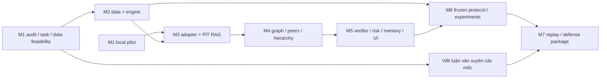

# Roadmap 8–12 tuần, giữ đầy đủ phạm vi

Khung tính từ khi bắt đầu thực hiện, chưa có deadline chính thức. Tuần có thể
chồng nhau khi công việc độc lập; viết luận văn ngay từ M1. Thời gian dưới đây
là ước lượng engineering/annotation/phân tích của một người, không cam kết
hoàn tất nghiên cứu hoặc được chấm đạt. Nếu feasibility/compute không đủ, tăng
tài nguyên/thời gian với số đo; không tự loại graph/peer/verifier/memory.

| Mốc / tuần đề xuất | Dependencies | Artifacts/lệnh kiểm chứng đích | Pass / fail trước chuyển mốc | Công sức ước lượng |
|---|---|---|---|---|
| M1, tuần 1–2: audit/spec/literature/data + local pilot | repo/máy/nguồn | hồ sơ research; doctor; 20–30 case thật và benchmark | pass khi task/selection/model feasibility có bằng chứng; audit xong không đồng nghĩa pilot xong | 20–35h + inference pilot |
| M2, tuần 2–4: snapshot/schema/gateway + quant engine | task + source feasibility; độc lập LLM | ingest/pilot data card, immutable hash/version registry; baseline CLI | late/revision/quarantine tests; calendar/fees/cash/settlement examples; unknown adjustment không gọi strict | 35–60h |
| M3, tuần 4–5: adapter và PiT single-agent | model measured + M2 evidence | validated JSON adapter; vector/lexical/structured; L0/L1/L2 runner | no future corpus statistics; gold locators; timeout/JSON/OOM/ABSTAIN; model digest fixed | 25–45h |
| M4, tuần 5–7: graph/peer/full hierarchy | facts/peer mapping + M3 | temporal nodes/edges, 4 specialists/planner/synthesizer trace | edge/fact lineage valid, branch budget bounded, real peer cases | 35–55h |
| M5, tuần 6–8: verifier/risk/memory/audit/UI/E2E | M3/M4 contracts | quote/numeric/semantic checks, memory isolation, persisted trace, UI outputs thật | future→past replay invariant; no rejected memo/context; full ABSTAIN path; immutable E2E snapshot | 30–50h |
| M6, tuần 8–10+: freeze và full experiments | data coverage/gold + M2–M5 | freeze config/splits; matrix CLI; raw outputs/metrics/CI/error analysis | complete samples incl failures, no mock/diagnostic mixing, paired/block inference | 35–65h + compute/annotation |
| M7, tuần 10–12+: reproducibility/thesis/demo/slides | method/results/limits | replay package; chương/hình/bảng/case đúng/lỗi; demo và hỏi bảo vệ | mỗi thesis claim có artifact/run/source; unknown có placeholder; cold replay succeeds | 30–50h |

Tổng sơ bộ 210–360 giờ công, cộng thời gian inference/thu thập/chấm nhãn có thể
lớn. Giờ làm mỗi tuần chưa xác định. Không suy ra 8 tuần đủ chỉ từ checklist.
Các CLI chưa hiện thực trong cột artifacts là tiêu chí đích, không lệnh đang chạy.
Hiện lệnh có thật: test/lint/pit-demo/data/app/doctor qua run.ps1.
Ngày 02/11/2026 bổ sung `backtest-synthetic`: động cơ thực thi và lịch
Q0/Q1 trên kịch bản tự tạo, có ledger/replay. Đây mới là nền tảng M2;
chưa đạt tiêu chí calendar/settlement/giá thật hoặc đủ năm baseline.
Xem [mốc 33](33-synthetic-execution-engine.md).
`market-snapshot` ở [mốc 34](34-market-price-snapshots.md) lưu phản hồi
giá KBS 2021–2024 và kiểm chất lượng/replay; ba mã có 2.994 bar, VNINDEX
bị chặn vì quan hệ OHLC. Chưa chuyển các bar vào thực thi hoặc coi lịch,
adjustment và tính khả dụng là đã xác minh.

## Ước lượng compute có thể kiểm tra

Đếm calls theo trace từng arm: `C = sum_samples sum_arms calls(sample,arm)`.
Thời gian sequential dự kiến `T = C * measured_median_call_latency`, cộng cold
loads, embedding/index, retries và I/O. Ước lượng p95/worst case và giờ máy rảnh
riêng. Không lấy latency GPT-4o-mini trong paper để dự báo máy RTX 3050.

Ví dụ **giả định**, không số đo: 300 samples × tổng 60 calls/sample qua các
arms/ablation = 18.000 calls. Nếu median 20/60/180s thì khoảng 100/300/900 giờ
inference tuần tự trước overhead. 2.000 input + 400 output tokens/call tương
ứng 43,2 triệu token; actual context/thinking/retries có thể khác nhiều.
24 case pilot và traces sẽ thay các giả định này bằng số đo.

Compute plan không giảm scientific scope: pilot subset để phát triển; final
sample size tính theo coverage/power và ngân sách thực. Nếu full matrix vượt
deadline, trao đổi bổ sung RAM/GPU/máy hoặc kéo dài; API/cloud chỉ bật khi có
ngân sách xác nhận. Local không phí token API nhưng có giờ máy/điện/khấu hao.

RAM tổng 15,4 GiB/VRAM4 GiB đã đo, RAM trống khoảng2,7 GiB lúc audit. Bắt đầu
một model/1 concurrent request, bounded context, không giữ nhiều models. Cần
đo model+KV cache/offload và embedding riêng; dung lượng file không là memory
peak. Không tự đóng ứng dụng của người dùng để lấy RAM.

## Source/model không đạt thì làm gì?

- Timestamp/old revision thiếu: giữ quarantine, thử official listing/sở/IR khác;
  conservative cohort chỉ báo riêng, không downgrade strictness âm thầm.
- PDF scanned khó: kiểm OCR mẫu, thêm correction/gold annotation, báo coverage;
  không giao số liệu hoàn toàn cho LLM hoặc bỏ ngành khó không giải thích.
- Local JSON/numeric/tiếng Việt không đạt: error analysis, bounded context/prompt
  trên dev; thử candidate khác giữ adapter/contracts. Không mặc định 8b sẽ vừa4GB.
- Inference chậm/OOM: đo giảm context/offload, serial schedule, tài nguyên bổ sung;
  vẫn phát triển data/engine/gateway/docs độc lập.

## Viết và bảo vệ theo milestone

M1 viết vấn đề/RQ/literature và contribution ledger; M2 data card/threat model;
M3–M5 phương pháp/hiện thực/diagrams; M6 thực nghiệm và lỗi, kể cả kết quả âm;
M7 limits/conclusion/replay/demo. Mỗi claim dẫn artifact/run/source. Hình/bảng
kết quả chỉ từ dữ liệu thật; chưa có thì ghi "chưa chạy". Demo gồm một case đúng,
một case lỗi/ABSTAIN; sinh slide khi đã có artifact phù hợp mẫu trường.
